# Machine Learning Basics

## Understanding AI Hierarchy

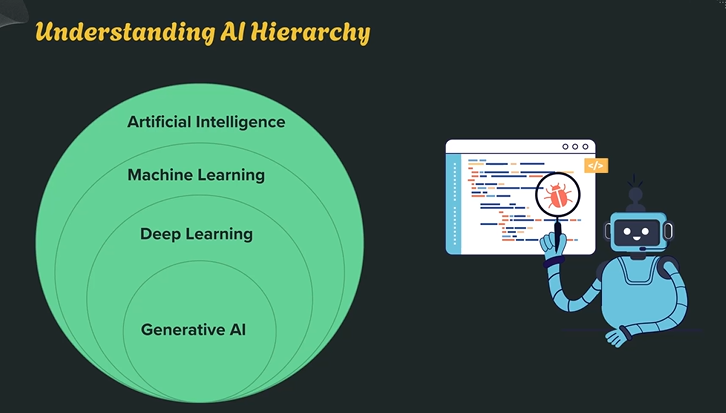

## Aritificial Intelligence

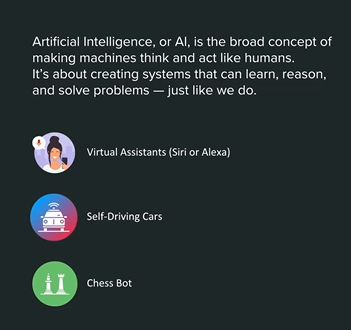

## Machine Learning

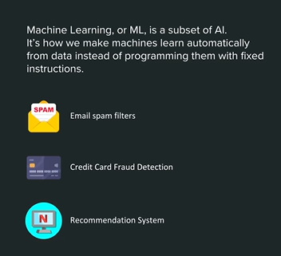

## Deep Learning

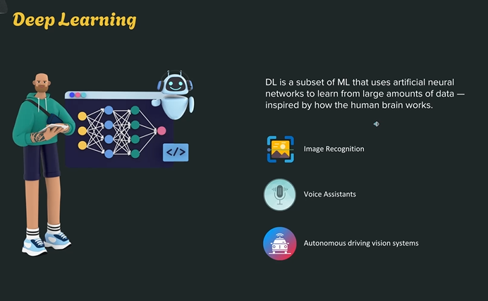

## Generative AI

can I say Generative Deep Learning?

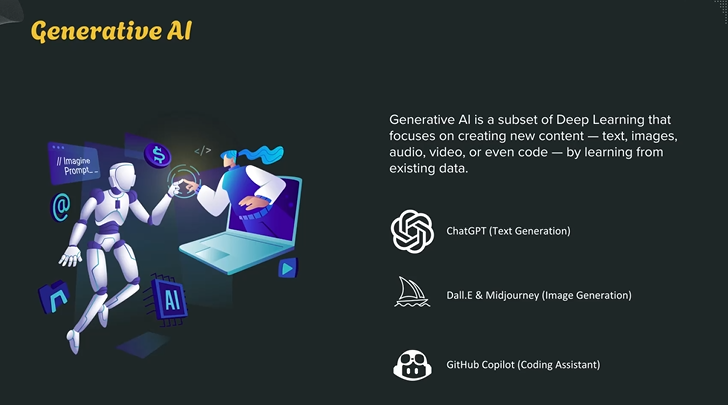

# 2.3 Supervised Learning

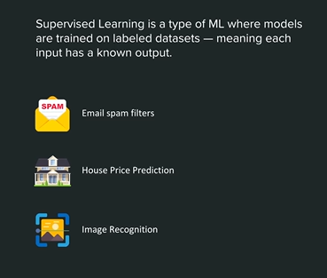

## Types of Supervised Learning

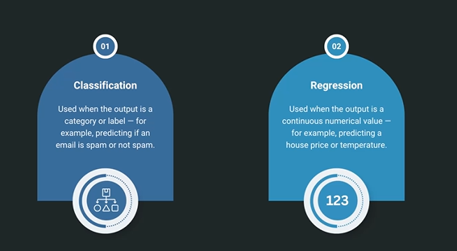

## Classification Models

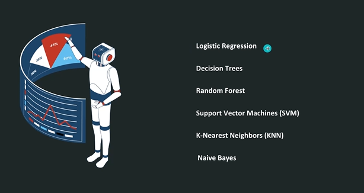

## Regression Models

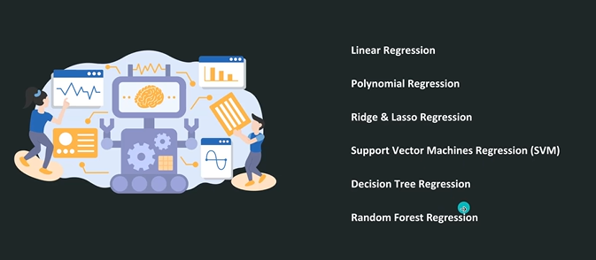

## Applications

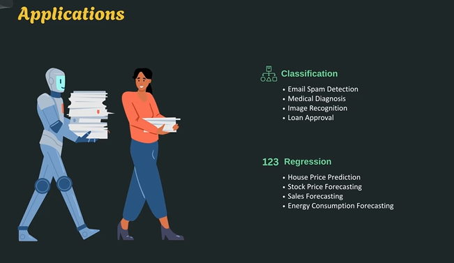

# 2.4. Unsupervised Learning

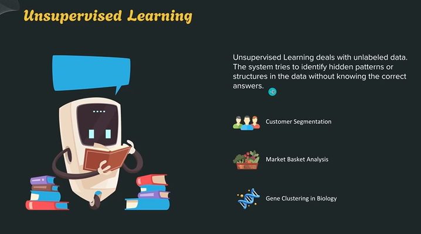

## Types of Unsupervised Learning

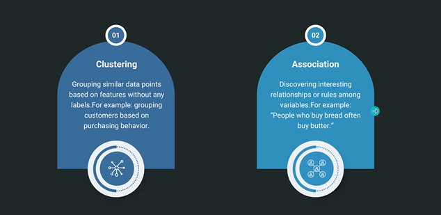
